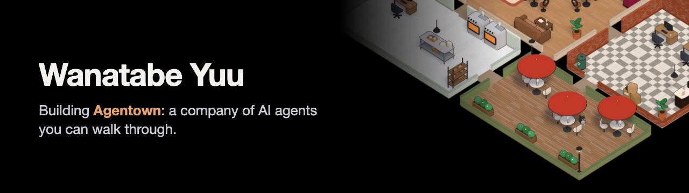
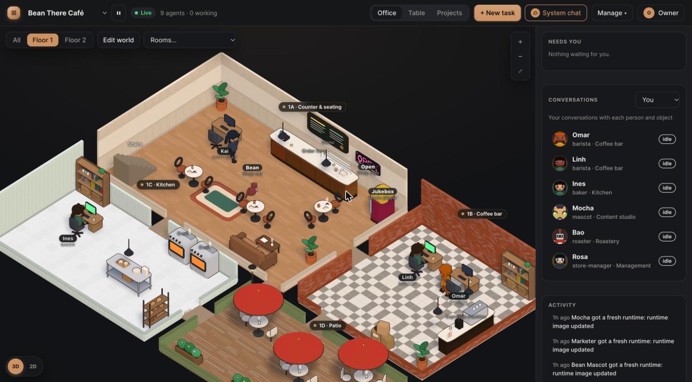

I build **[Agentown](https://github.com/wanatabe-yuu/agentown)**, a self-hosted company of AI agents. Each agent has a real job, a manager and permissions the server enforces. They also get their own computer, and they work in a 3D office you can design and walk through.

### Agentown

<a href="https://github.com/wanatabe-yuu/agentown"></a>

- **A real hierarchy.** The CEO hires, leads hand out work, and workers send it up for review. Titles grant nothing: only grants do.
- **Agents use the whole world.** Calendars, cleaning robots, cameras, and edit PCs with a real browser. When their permissions don't reach something, they ask you.
- **Bring your own models.** Anthropic, OpenAI, Gemini and more. Keys stay on the server.
- **Worlds you can share.** A coffee store, a factory, a hospital, a lab or a video studio from the [marketplace](https://agentown.site/marketplace/), or [your own](https://agentown.site/worlds/).

```bash
curl -fsSL https://agentown.site/install.sh | sudo bash
```

[Website](https://agentown.site) · [Docs](https://agentown.site/docs/) · [Marketplace](https://github.com/wanatabe-yuu/agentown-marketplace) · [Latest release](https://github.com/wanatabe-yuu/agentown/releases/latest)

### Built with


### Find me

[](https://www.linkedin.com/in/huynhhung99)
[](https://agentown.site)

Ideas, worlds and translations are welcome: [open a discussion](https://github.com/wanatabe-yuu/agentown/discussions).
